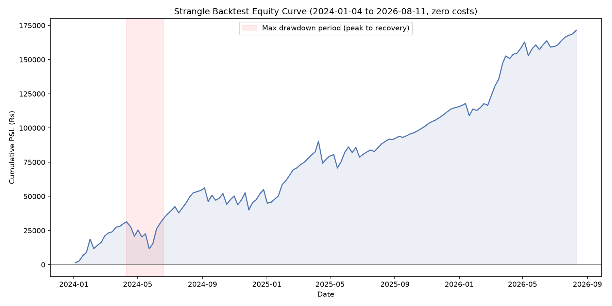
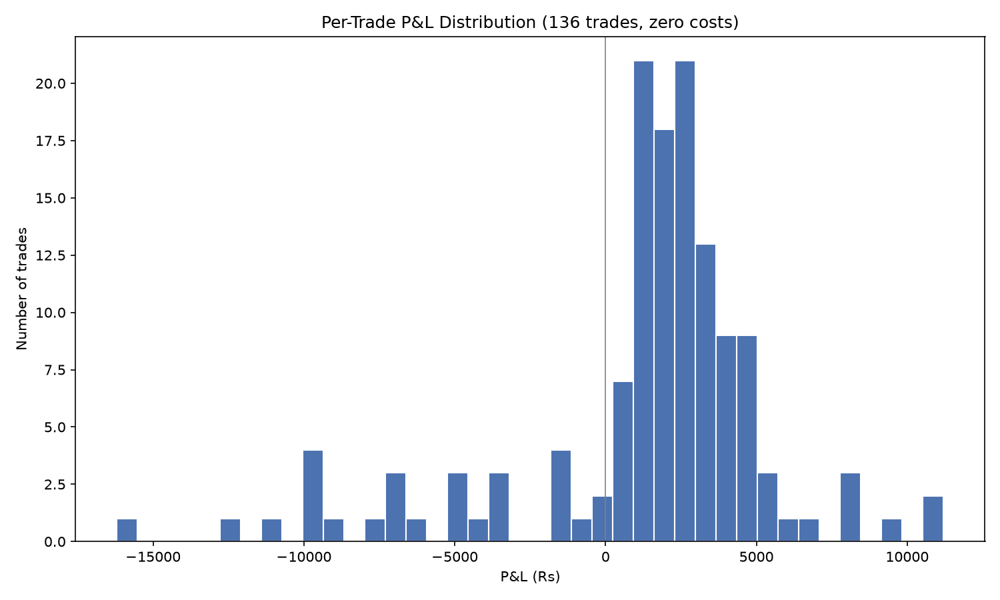

# options-research

A paper-trading research project testing an intraday **short strangle**
options strategy on **NIFTY 50** (India's benchmark stock index), using
real historical option prices from NSE.

**Educational/research project. Not financial advice. No broker is
connected, no order has ever been placed, and every result below is
simulated.**

## What the strategy is

A short strangle sells a call above the current price and a put below
it at the same time, collecting premium upfront. The specific version
studied here:

- Traded only on NIFTY 50.
- Entered at market open, closed before market close, the same day —
  never held overnight.
- Only traded on the index's weekly options expiry day.
- Strikes placed 0.5% away from that morning's opening price on each
  side.

See [RESULTS.md](RESULTS.md) for the full write-up of findings, and
[RESULTS_EXTENSIONS.md](RESULTS_EXTENSIONS.md) and the [journal/](journal)
folder for the follow-up experiments and the pre-registration notes
that back them.

## Headline results (corrected baseline, 137 trades)

Every NIFTY weekly expiry day from 4 January 2024 to 11 August 2026,
using real, traded option prices. Figures are in **points** (not
rupees) because NIFTY's lot size changed four times over this period —
points is the unit that stays comparable across the whole sample; see
[RESULTS_EXTENSIONS.md](RESULTS_EXTENSIONS.md) for the lot-size audit
behind this correction.

| | |
|---|---|
| Trades | 137 |
| Win rate | 81.02% |
| Total P&L | +2,672.20 pts |
| Worst single trade | -249.20 pts (2025-04-17, ≈ -Rs 18,690) |
| Max drawdown | 303.50 pts |

**Was it just luck?** The single largest one-day NIFTY move in the
whole period — the 2024-06-04 election-result crash — happened to not
fall on an expiry day, so the strategy was never exposed to it.
Simulated against that day's real option prices, the loss would have
been about **-777 pts, over 3x worse** than any loss that actually
occurred. See "Was the good result just luck?" in `RESULTS.md` for the
full discussion.




## How it works

1. `src/download_bhavcopy.py` downloads NSE's daily options "bhavcopy"
   file for each weekly expiry day in the target range.
2. `src/extract_chain.py` pulls the same-day-expiry NIFTY option prices
   out of each file and merges in that day's NIFTY opening price.
3. `src/backtest_strangle.py` replays the strategy against every one
   of those real trading days.
4. The other scripts in `src/` run follow-up experiments (costs,
   event-day filters, protective wings, pledged-collateral leverage,
   etc.) against that same backtest.

## Installing and running

```bash
python3 -m venv .venv
source .venv/bin/activate
pip install -r requirements.txt
```

Download and build the data (not included in this repo — see **Data**
below), then run a script, e.g.:

```bash
python src/download_bhavcopy.py
python src/extract_chain.py
python src/backtest_strangle.py
```

Run the tests with:

```bash
python -m pytest tests/ -v
```

## Data

This repo does **not** include the underlying market data, because it
is sourced from third parties under their own licence terms:

- **NIFTY 50 daily prices** — Yahoo Finance, via `yfinance`.
- **NIFTY option prices** — NSE's historical bhavcopy archive (only
  goes back to 1 January 2024).

`src/download_bhavcopy.py` and `src/extract_chain.py` regenerate both
locally. `data/raw/download_manifest.csv` and the `*_SOURCE.txt` files
are kept as a provenance record (what was fetched, from where, when) —
without the data itself.

## Limitations

- Paper trading only — these numbers were never traded with real
  money, and nothing here accounts for slippage, fills, or broker
  behavior beyond the cost assumptions stated in `RESULTS.md`.
- Real, verified option data only exists from 2024-01-04 onward (NSE's
  archive limit). Anything about earlier years is an explicitly-labeled
  estimate.
- See `RESULTS.md`'s "Was the good result just luck?" section — the
  single worst trading day in the sample period happened to not be an
  expiry day, which flatters every headline number in this project.

## License

MIT — see [LICENSE](LICENSE).
